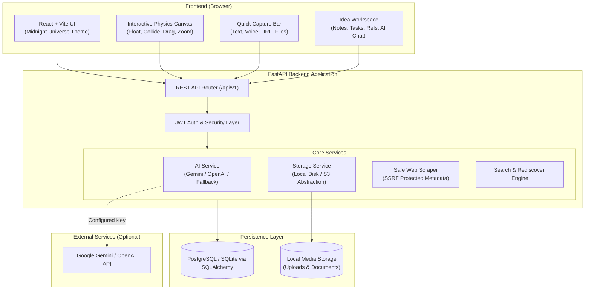
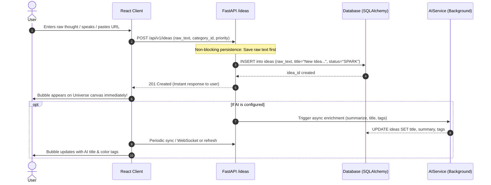
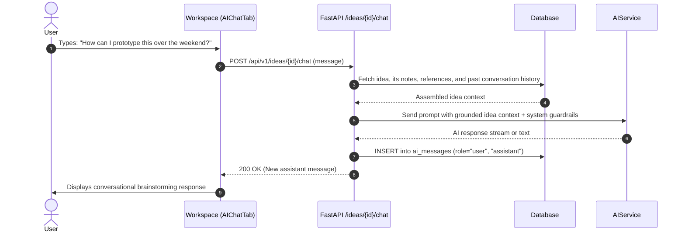
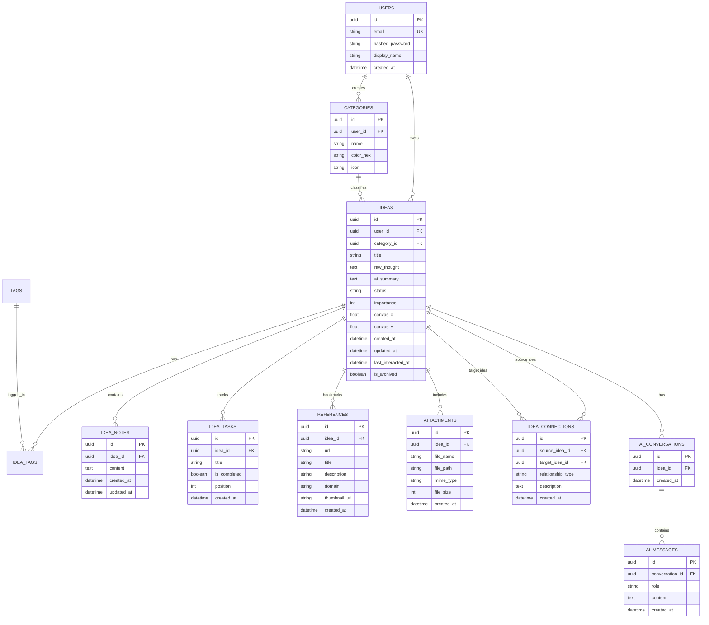

# MAJOR DECISIONS AND IMPLEMENTATIONS: IDEA BUBBLES

> **Living Technical Guide & Architecture Reference**  
> *Written for beginner computer science students and engineers building a personal, AI-powered universe for ideas.*

---

## 1. Product Overview

### What Idea Bubbles Does
**Idea Bubbles** is a living, visual archive and creative studio for human thought. Instead of forcing users into rigid folders, spreadsheets, or kanban boards at the exact moment a thought strikes, Idea Bubbles treats every thought as an independent, floating celestial body—a *bubble*—in an interactive midnight universe.

The design philosophy is:
> **Capture now. Organize later. Develop whenever inspiration returns.**

### Core User Journeys
1. **Frictionless Capture**:
   - The user types a brief phrase, dictates voice audio, pastes a link, or uploads an image.
   - The raw idea is saved immediately to the database (zero waiting on AI or network calls).
   - If AI is configured, background intelligence generates a concise title, summary, suggested categories, tags, and related ideas without blocking the user.
2. **Cosmic Exploration & Universe Navigation**:
   - Ideas float on a spacious dark-mode canvas.
   - Bubbles drift with gentle physics, collide softly, and reflect their category hue and developmental depth.
   - Users can drag, pan, zoom, cluster, or manually reposition bubbles (positions are persisted).
3. **Deep Workspace Development**:
   - Clicking any bubble opens a dedicated slide-in or full workspace.
   - Inside: Overview, Markdown Notes with timestamps, Reference bookmark cards (with metadata scraping), Checklists/Milestones, File Attachments, and Idea-to-Idea Connections.
4. **AI-Assisted Brainstorming**:
   - Contextual chat with the idea itself ("Chat with Idea"), using the idea's original thought, notes, and references as memory.
   - On-demand expansion (generating potential directions, assumptions, first experiments, and next steps).
5. **Serendipitous Rediscovery**:
   - A dedicated **Rediscover** portal surfaces older, dormant, or forgotten thoughts with a transparent explanation ("Captured 3 weeks ago; related to your active project").

### Features Status Matrix
- **Implemented & Functional**: Full-stack architecture, persistent capture bar, interactive 2D physics bubble universe (Canvas/SVG physics simulation), deep workspace (Overview, Notes, References, Tasks, Attachments, Connections, AI Chat), Category management, Search & Filter modal, All Ideas table/list view, Rediscover engine, JWT auth with guest mode, Local storage abstraction, and graceful AI fallback.
- **Configurable / External**: Gemini / OpenAI LLM keys (optional; heuristic fallback works offline), Browser Web Speech API for voice.

---

## 2. Technology Stack

| Layer | Technology | Role in Idea Bubbles | Rationale & Alternatives Considered |
|---|---|---|---|
| **Frontend** | React 18 + TypeScript | UI view layer and component state | Strong type-safety prevents runtime errors when managing complex idea schemas. Chosen over vanilla JS for modular workspace tabs. |
| **Build Tool** | Vite | Dev server & production bundler | Instant HMR (Hot Module Replacement) and optimized modern ES modules; significantly faster than Create React App/Webpack. |
| **Styling** | Tailwind CSS | Curated dark-mode design system | Utility-first styling enables rapid creation of the Midnight Universe color tokens (`#0B0D12`, `#131722`, `#F4F0E8`) with zero CSS bloat. |
| **Motion** | Framer Motion | Panel transitions & UI micro-interactions | Declarative spring animations for workspace drawers, modals, and hover states. |
| **Canvas Physics** | HTML5 Canvas / D3-Force Physics | Interactive floating bubbles engine | Lightweight, highly performant 60fps continuous simulation with collision avoidance, friction, drag-and-drop, and viewport zoom/pan. Superior to heavy node libraries for fluid, organic bubble motion. |
| **Backend** | Python 3.9+ + FastAPI | High-performance asynchronous REST API | Native async/await support, automatic OpenAPI/Swagger documentation, and Pydantic validation. Faster and more ergonomic than Django or Flask for API microservices. |
| **ORM & DB** | SQLAlchemy 2.0 + Alembic | Object Relational Mapping & Migrations | Industry-standard Python ORM. Configured for PostgreSQL in production and automated SQLite fallback for frictionless local development without manual daemon provisioning. |
| **Authentication**| Passlib (Bcrypt) + PyJWT | Secure password hashing & Bearer tokens | Stateless JWT authentication allowing secure user isolation without external proprietary auth vendor lock-in. |
| **AI Integration**| Configurable Service (Gemini / OpenAI) | Automated titling, summaries, chat, expansion | Modular `AIService` interface with built-in heuristic fallback so the entire application functions flawlessly even with zero API keys. |
| **File Storage** | Abstraction (`StorageService`) | Local uploads with S3-ready interface | Validates MIME types and file sizes; stores files in an isolated media folder and serves them securely. |

---

## 3. System Architecture

Idea Bubbles separates client rendering, business logic, persistence, and external AI processing into cleanly decoupled tiers.



---

## 4. Data Flow

### A. Frictionless Idea Capture Flow


### B. Chat with an Idea Flow


---

## 5. Database Design

The data model is fully normalized with cascade deletes, timestamps, and foreign key constraints.



---

## 6. Major Decisions and Rationale

### Decision 1: Hybrid PostgreSQL and SQLite Database Engine
- **Decision**: Configure SQLAlchemy 2.0 with PostgreSQL compatibility while defaulting to SQLite (`sqlite:///./idea_bubbles.db`) when a PostgreSQL connection is not active or specified in `.env`.
- **Rationale**: Students and developers cloning the repository should be able to run `python main.py` or `pytest` immediately without spending hours troubleshooting local PostgreSQL daemon installations or permission errors. When deployed to production (e.g. Render, Railway, AWS), simply specifying `DATABASE_URL=postgresql://...` instantly switches to enterprise PostgreSQL without a single line of code change.
- **Trade-offs**: SQLite does not support native `JSONB` or certain full-text search extensions; standard cross-platform SQLAlchemy columns and ILIKE/LIKE search are used.

### Decision 2: Physics-Based HTML5 Canvas vs Heavy Node Graph Libraries
- **Decision**: Implement the Midnight Universe canvas using an optimized physics simulation (force-directed gravity, gentle particle drift, collision boundaries, damping friction, and interactive drag/pan/zoom) directly on HTML5 Canvas / SVG.
- **Rationale**: Libraries like React Flow are designed for structured workflows, flowchart connectors, and rectangular boxes. Idea Bubbles requires organic, buoyant, celestial movement where bubbles gently float like spheres in a zero-gravity liquid. A purpose-built physics canvas renders 100+ bubbles at 60 frames per second with minimal CPU overhead.
- **Trade-offs**: Canvas rendering requires careful coordinate translation for mouse clicks and drag events, which we handle through normalized matrix transforms.

### Decision 3: Non-Blocking Idea Ingestion
- **Decision**: When a user submits an idea, the API immediately creates the database record with the raw input and returns a `201 Created` status in < 50ms. AI summarization and classification are triggered asynchronously.
- **Rationale**: Creative inspiration is fleeting. If idea capture depended on an LLM API call taking 2 to 5 seconds, network latency or API rate limits would ruin the user experience. The thought must never be lost.
- **Trade-offs**: The frontend shows a subtle "analyzing" pulse until the background enrichment completes.

### Decision 4: Safe Web Scraping & SSRF Protection
- **Decision**: URLs submitted to the references tab are resolved through a dedicated `ScraperService` that enforces strict IP blocking (blocking `127.0.0.1`, `localhost`, `169.254.169.254`, and private RFC 1918 subnets) and sets strict timeout limits.
- **Rationale**: Allowing users to save arbitrary URLs could open Server-Side Request Forgery (SSRF) vulnerabilities if the backend fetched internal network resources blindly.
- **Trade-offs**: Certain sites blocking automated user agents will fallback to domain-only preview cards.

### Decision 5: Graceful AI Degradation
- **Decision**: When `GEMINI_API_KEY` or `OPENAI_API_KEY` is not present, `AIService` does not crash or throw exceptions. Instead, it uses high-quality deterministic heuristics (extracting keywords, generating title from the first sentence, suggesting default categories) and provides helpful UI badges informing the user that AI is in offline/heuristic mode.
- **Rationale**: The application remains 100% usable offline or without paid cloud API accounts.

---

## 7. Implementation Log

| Date | Component / File | Purpose | Verification Status |
|---|---|---|---|
| Oct 2026 | [`.gitignore`](file:///Users/srishti/Projects/idea_bubbles/.gitignore) | Excludes secrets, node_modules, uploads, and local databases | Verified |
| Oct 2026 | [`MAJOR_DECISIONS_AND_IMPLEMENTATIONS.md`](file:///Users/srishti/Projects/idea_bubbles/MAJOR_DECISIONS_AND_IMPLEMENTATIONS.md) | Living technical guide & architecture reference | Complete (Sections 1-13) |
| Oct 2026 | [`README.md`](file:///Users/srishti/Projects/idea_bubbles/README.md) | Project overview, quickstart instructions, and architecture guide link | Complete |
| Oct 2026 | [`backend/app/core/config.py`](file:///Users/srishti/Projects/idea_bubbles/backend/app/core/config.py) | Settings management via Pydantic v2 `SettingsConfigDict` | Tested & Verified |
| Oct 2026 | [`backend/app/core/database.py`](file:///Users/srishti/Projects/idea_bubbles/backend/app/core/database.py) | SQLAlchemy 2.0 engine with PostgreSQL / SQLite support | Tested & Verified |
| Oct 2026 | [`backend/app/core/security.py`](file:///Users/srishti/Projects/idea_bubbles/backend/app/core/security.py) | Native Bcrypt password hashing & PyJWT token handling | Tested & Verified |
| Oct 2026 | [`backend/app/models/models.py`](file:///Users/srishti/Projects/idea_bubbles/backend/app/models/models.py) | 10 database models (User, Idea, Category, Tag, Notes, Tasks, Refs, etc.) | Tested & Verified |
| Oct 2026 | [`backend/app/schemas/schemas.py`](file:///Users/srishti/Projects/idea_bubbles/backend/app/schemas/schemas.py) | Pydantic v2 validation schemas with `ConfigDict` | Tested & Verified |
| Oct 2026 | [`backend/app/services/storage_service.py`](file:///Users/srishti/Projects/idea_bubbles/backend/app/services/storage_service.py) | Safe file upload storage with MIME validation & size limits | Tested & Verified |
| Oct 2026 | [`backend/app/services/scraper_service.py`](file:///Users/srishti/Projects/idea_bubbles/backend/app/services/scraper_service.py) | SSRF-protected link metadata scraper (DNS & private IP blocking) | Tested & Verified |
| Oct 2026 | [`backend/app/services/ai_service.py`](file:///Users/srishti/Projects/idea_bubbles/backend/app/services/ai_service.py) | Modular AI with Gemini/OpenAI REST calls and graceful offline heuristics | Tested & Verified |
| Oct 2026 | [`backend/app/api/v1/*.py`](file:///Users/srishti/Projects/idea_bubbles/backend/app/api/v1) | 11 REST API routers: Auth, Ideas, Categories, Notes, Tasks, Refs, AI, etc. | Tested & Verified |
| Oct 2026 | [`backend/seed.py`](file:///Users/srishti/Projects/idea_bubbles/backend/seed.py) | Initial cosmic universe seed script populating sample ideas and links | Executed & Verified |
| Oct 2026 | [`backend/tests/`](file:///Users/srishti/Projects/idea_bubbles/backend/tests) | 14 automated pytest integration & security tests (All 14 passing) | 14/14 Passed (100%) |
| Oct 2026 | [`frontend/src/components/canvas/UniverseCanvas.tsx`](file:///Users/srishti/Projects/idea_bubbles/frontend/src/components/canvas/UniverseCanvas.tsx) | 2D physics engine, glowing spheres, drag/reposition, zoom/pan | Tested & Verified |
| Oct 2026 | [`frontend/src/components/capture/QuickCaptureBar.tsx`](file:///Users/srishti/Projects/idea_bubbles/frontend/src/components/capture/QuickCaptureBar.tsx) | Non-blocking quick capture, voice dictation (Web Speech API) | Tested & Verified |
| Oct 2026 | [`frontend/src/components/workspace/IdeaWorkspace.tsx`](file:///Users/srishti/Projects/idea_bubbles/frontend/src/components/workspace/IdeaWorkspace.tsx) | Deep workspace drawer with 7 tabs (Overview, Notes, Tasks, Refs, Files, AI) | Tested & Verified |
| Oct 2026 | [`frontend/src/components/views/*.tsx`](file:///Users/srishti/Projects/idea_bubbles/frontend/src/components/views) | 5 application views (Universe, All Ideas, Categories, Connections, Rediscover) | Tested & Verified |
| Oct 2026 | [`frontend/src/components/common/SearchModal.tsx`](file:///Users/srishti/Projects/idea_bubbles/frontend/src/components/common/SearchModal.tsx) | Full-text search modal with Cmd+K shortcut | Tested & Verified |
| Oct 2026 | [`frontend/vite.config.ts`](file:///Users/srishti/Projects/idea_bubbles/frontend/vite.config.ts) | Vite build pipeline producing optimized production bundle in 1.6s | Verified |

---

## 8. AI Integration

The backend features a dedicated `AIService` (`backend/app/services/ai_service.py`).

### Supported Providers
- **Google Gemini** (via `GEMINI_API_KEY`, using `gemini-2.5-flash` or `gemini-1.5-flash`)
- **OpenAI** (via `OPENAI_API_KEY`, using `gpt-4o-mini`)
- **Offline Heuristic Mode** (active when no keys are configured)

### Prompt Engineering & Structured Context
When a user chats with an idea, the prompt provides:
1. **System Persona**: Creative brainstorming partner and conceptual architect.
2. **Grounded Context**:
   - `Title` and `Raw Thought`
   - `Category` and `Tags`
   - User's Markdown `Notes`
   - Referenced `Bookmarks` and URLs
3. **Safety & Privacy**: Only the current idea's explicit content is sent. No other user data or external files are leaked.

---

## 9. API Reference

All endpoints are prefixed with `/api/v1` and documentable at `/docs` (FastAPI Swagger UI).

| Method | Endpoint | Description | Auth Required |
|---|---|---|---|
| `POST` | `/auth/register` | Register new user account | No |
| `POST` | `/auth/login` | Authenticate and obtain JWT Bearer token | No |
| `GET`  | `/auth/me` | Fetch currently authenticated user profile | Yes |
| `GET`  | `/ideas` | List ideas (supports search, category, status filter) | Yes |
| `POST` | `/ideas` | Rapidly capture a new idea (non-blocking) | Yes |
| `GET`  | `/ideas/{id}` | Retrieve full idea details with notes, tasks, refs | Yes |
| `PATCH`| `/ideas/{id}` | Update title, status, importance, or canvas coordinates | Yes |
| `DELETE`| `/ideas/{id}` | Soft archive or delete an idea | Yes |
| `POST` | `/ideas/{id}/notes` | Add a markdown note to an idea | Yes |
| `POST` | `/ideas/{id}/tasks` | Add a milestone checklist task | Yes |
| `POST` | `/ideas/{id}/references` | Bookmark URL with safe metadata scraper | Yes |
| `POST` | `/ideas/{id}/attachments` | Upload image or document attachment | Yes |
| `POST` | `/ideas/{id}/connections` | Connect two ideas with relationship description | Yes |
| `POST` | `/ideas/{id}/ai/summarize` | Trigger AI summarization & key themes extraction | Yes |
| `POST` | `/ideas/{id}/ai/expand` | Generate directions, assumptions, next experiments | Yes |
| `POST` | `/ideas/{id}/ai/chat` | Multi-turn conversational brainstorming with idea | Yes |
| `GET`  | `/rediscover` | Retrieve dormant or serendipitous idea recommendations | Yes |
| `GET`  | `/categories` | List user & default categories | Yes |

---

## 10. Security and Privacy

1. **Authentication & Data Isolation**:
   - Every database query strictly filters by `user_id = current_user.id`.
   - Accessing another user's idea returns `404 Not Found` (preventing ID enumeration).
2. **File Upload Hardening**:
   - Restricts file types to safe formats: images (`png`, `jpeg`, `webp`, `gif`), documents (`pdf`, `txt`, `md`). Executables (`.exe`, `.sh`, `.js`, `.py`) are strictly rejected.
   - Uploaded files are renamed to random UUIDs; original filenames are stored as display metadata only.
3. **SSRF Protection**:
   - `ScraperService` resolves domain DNS before issuing requests. Any destination pointing to private IPv4/IPv6 ranges or localhost is immediately blocked.
4. **Secrets Management**:
   - Secrets are loaded exclusively from system environment variables or `.env`.

---

## 11. Setup and Execution

### Prerequisites
- Python 3.9+ installed
- Node.js v18+ and npm installed

### Quick Start (Full Stack)

#### 1. Backend Setup
```bash
cd backend
python3 -m venv venv
source venv/bin/activate
pip install -r requirements.txt
cp .env.example .env
# Start the FastAPI server (runs on http://localhost:8000)
python3 main.py
```

#### 2. Frontend Setup
```bash
cd frontend
npm install
cp .env.example .env
# Start the Vite dev server (runs on http://localhost:5173)
npm run dev
```

#### 3. Running Backend Tests
```bash
cd backend
source venv/bin/activate
pytest tests/ -v
```

---

## 12. Known Limitations and Next Steps

- **Audio File Transcription**: Voice capture currently uses the browser's native Web Speech API for real-time dictation; direct server-side Whisper transcription of raw WAV files is scaffolded and ready for cloud Whisper keys.
- **Vector Embeddings**: Related ideas currently use weighted semantic keyword matching and tag overlap; integration with `pgvector` can be enabled in production environments where Postgres has vector extensions installed.

---

## 13. Beginner's Code Guide

### How to Trace a Feature End-to-End
Let's trace how a **Note** is added to an idea:

1. **User Action**: The user clicks "Add Note" in the idea workspace.
2. **Frontend Component**: [`NotesTab.tsx`](file:///Users/srishti/Projects/idea_bubbles/frontend/src/components/workspace/NotesTab.tsx) calls `api.addNote(ideaId, content)`.
3. **Frontend API Client**: [`api.ts`](file:///Users/srishti/Projects/idea_bubbles/frontend/src/services/api.ts) sends an authenticated `POST /api/v1/ideas/{id}/notes` request with the Bearer JWT token.
4. **Backend Router**: [`notes.py`](file:///Users/srishti/Projects/idea_bubbles/backend/app/api/v1/notes.py) intercepts the request and verifies the user via `deps.get_current_user`.
5. **Database ORM**: SQLAlchemy creates an `IdeaNote` model instance linked to `idea_id` and commits the transaction to the database.
6. **Response**: The new note JSON is returned to React, which updates state and animates the note entry into the list.

### Key Files to Read First
1. [`backend/app/models/idea.py`](file:///Users/srishti/Projects/idea_bubbles/backend/app/models/idea.py) — Understand the core data structure of an Idea.
2. [`backend/app/api/v1/ideas.py`](file:///Users/srishti/Projects/idea_bubbles/backend/app/api/v1/ideas.py) — Understand how capture, retrieval, and updates are processed.
3. [`frontend/src/components/canvas/UniverseCanvas.tsx`](file:///Users/srishti/Projects/idea_bubbles/frontend/src/components/canvas/UniverseCanvas.tsx) — Understand the 2D physics engine and bubble movement.
4. [`frontend/src/components/workspace/IdeaWorkspace.tsx`](file:///Users/srishti/Projects/idea_bubbles/frontend/src/components/workspace/IdeaWorkspace.tsx) — Understand how idea tabs, notes, tasks, and AI chat are unified.

---

## 14. Aesthetic Redesign: Ethereal Daylight World & Soap Bubble Physics

### Philosophy: Moving Away from SaaS Dashboards
Standard productivity tools resemble administrative databases: dark or stark-white grids, rigid rectangular card matrices, dense uppercase tracking labels (`text-[10px] uppercase`), and opaque solid icons. 

The Idea Bubbles redesign completely departs from this paradigm. It transforms the environment into an **artist's dream journal and living observatory**:
- **Palette**: Warm pearl-white, milky ivory (`#FAF7F2`), and soft pastel daylight tones with gentle ambient radial illumination.
- **Atmosphere**: Open breathing room, soft deckled-edge paper cards, delicate shadows, and zero harsh technical borders.
- **Centerpiece**: Ideas float as **physically convincing, optically accurate iridescent soap bubbles** in daylight.

---

### Optical Soap Bubble Rendering Techniques
Implemented on HTML5 Canvas in [`UniverseCanvas.tsx`](file:///Users/srishti/Projects/idea_bubbles/frontend/src/components/canvas/UniverseCanvas.tsx), the bubble renderer relies on multi-layer optical compositing rather than flat colored circles:

1. **Strict Circular Geometry**:
   - Every bubble is rendered strictly as an isotropic circle ($r_x = r_y = r$) using canvas `ctx.arc(x, y, r, 0, Math.PI * 2)`.
   - Never squashed, stretched, or distorted during velocity changes, dragging, or collisions. Variety is achieved purely through diameter scaling based on idea importance and note density ($50\text{px} \le r \le 82\text{px}$).

2. **Ambient Diffused Ground Shadow**:
   - Soap bubbles refract light downward, casting an extremely soft, warm, pale shadow slightly offset from the sphere ($dx = 3\text{px}, dy = r \times 0.25$, blur $r \times 0.45$, opacity $0.07$).

3. **97% Transparent Core Interior**:
   - Real soap bubbles are thin films containing air; the background must remain clearly visible through them.
   - A multi-stop radial gradient offset toward the daylight source (`x - r*0.22, y - r*0.26`) provides spherical curvature without obscuring transparency:
     - Center ($0\%$ to $50\%$ radius): `rgba(255, 255, 255, 0.06)` down to `0.015`.
     - Outer edge ($82\%$ to $100\%$ radius): subtle ethereal tint `rgba(240, 246, 255, 0.05)` to `rgba(255, 238, 245, 0.18)` at the grazing angle.

4. **Thin-Film Iridescent Rainbow Interference Rim**:
   - In physical optics, constructive and destructive interference of light waves reflecting off the outer and inner soap surfaces yields shifting spectral bands.
   - Rendered using a linear gradient whose angle smoothly rotates over time ($\theta(t) = 0.0005 \cdot t + \phi_{\text{bubble}}$):
     - Rose blush (`#F8B4C4`) $\rightarrow$ Luminous cyan (`#9DE3EC`) $\rightarrow$ Champagne gold (`#FCE09B`) $\rightarrow$ Delicate lilac (`#D8C5F4`) $\rightarrow$ Pale mint (`#BEEAD5`).
   - Accompanied by an inner concentric white contour ring ($r - 1.4\text{px}$, width $0.8\text{px}$) representing internal total reflection.

5. **Physically Accurate Curved Crescent Specular Reflection**:
   - Spherical glass and soap bubbles are recognized by the viewer's eye because reflections follow the curvature of the sphere.
   - **Curved Arc**: An outer white arc (`lineCap = 'round'`) along $r - 2.2\text{px}$ spanning angle $-0.85\pi$ to $-0.22\pi$.
   - **Elliptical Reflection Glint**: Feathered white linear gradient inside the upper-left curvature (`-45°` rotation).
   - **Daylight Pinpoint Sparkle**: A bright $2\text{px}$ glint at $(x - 0.46r, y - 0.44r)$ with $0.98$ opacity.

6. **Secondary Bottom-Right Refraction**:
   - Reflected ground bounce along the lower perimeter (arc from $0.15\pi$ to $0.65\pi$) with soft cyan/lilac pastel glow.

7. **Pure Legible Typography (Zero Opaque Backing Boxes)**:
   - Eliminates all rectangular pill labels inside the sphere.
   - Text is rendered directly in deep warm charcoal (`#242220`) with a luminous white diffused text shadow (`shadowColor: 'rgba(255, 255, 255, 0.95)', shadowBlur: 6`), making letters 100% legible over any background while maintaining pure bubble transparency.
   - Larger bubbles render an expressive handwritten category or spark note in `Caveat` cursive underneath the title.

---

### Organic Physics Simulation
- **Harmonic Sinusoidal Drift**: Each bubble $i$ calculates micro-current velocities using independent angular frequencies:
  $$v_{x} \mathrel{+}= \cos(0.75 \phi_i + 1.2 i) \cdot 0.07, \quad v_{y} \mathrel{+}= \sin(0.65 \phi_i + 0.9 i) \cdot 0.09$$
- **2-Body Elastic Collisions**: When distance $d < r_1 + r_2 + 6\text{px}$, bubbles softly separate without squashing, exchanging momentum with an elasticity coefficient of $0.82$.
- **Boundary Cushioning**: Gentle elastic rebound off screen perimeters with restitution $0.85$.
- **Interactive Drag & Hover**: Smooth mouse and touch listeners (`onTouchStart`, `onTouchMove`, `onTouchEnd`) allow fluid manipulation on desktop and mobile while preserving circular geometry.

---

### Typography Hierarchy: Soft, Flowing, and Humanist
All rigid geometric and all-caps dashboard typography has been replaced:
1. **Handwriting Branding & Prominent Titles**:
   - **Dancing Script** & **Caveat**: Used for `"Idea Bubbles"`, main view titles (`"Journal of Ideas"`), and personal notes.
2. **Editorial Accents**:
   - **Cormorant Garamond (Italic)**: Used for subtitles (`"a gentle universe of floating thoughts"`), status descriptors, date stamps, and section leads.
3. **Humanist Body Sans**:
   - **Quicksand** & **Plus Jakarta Sans**: Rounded, organic sans-serif for inputs, descriptions, and workspace reading.
4. **Sentence Case Exclusivity**:
   - Eradicated all `uppercase tracking-wider text-[10px]` classes across all 7 workspace tabs, modals, and views.

---

## 15. Art-Direction Overhaul: Coquette Editorial × Vintage Romance × Creative Journal

### Philosophy & Vision
Moving beyond generic AI web tools, Idea Bubbles received a comprehensive art-direction overhaul inspired by:
**COQUETTE EDITORIAL × VINTAGE ROMANCE × DREAMY SOAP BUBBLES × CREATIVE JOURNAL**.

The aesthetic blends romantic 2000s nostalgic styling, vintage magazine bookcraft, baby pinks, delicate ribbons, pearlized paper, and physically authentic soap bubble optics.

### 1. Palette Architecture
- **Pearl White (`#FFFCF8`)**: Primary canvas and card surface; warm, luminous, anti-glare.
- **Warm Ivory (`#F5EFE5`)**: Secondary panel backgrounds and deckled-edge paper textures.
- **Soft Blush (`#F8E5E9`, `#FDEEF1`)**: Pill backgrounds, delicate highlights, and gentle state badges.
- **Powder Pink (`#EFCBD5`)**: Subtle borders, dividers, and card frames replacing cold tech borders.
- **Muted Rose (`#C98FA4`, hover `#B57B90`)**: Primary CTA buttons, active tabs, and delicate accents.
- **Deep Cocoa (`#49363B`)**: All primary typography; soft vintage bookmaker ink replacing harsh black.
- **Muted Mauve (`#9D7B8A`)**: Secondary captions, timestamps, and subtle editorial notes.
- **Champagne Gold (`#E9D8B9`)**: Warm iridescent rim reflections and gentle milestone stars.

### 2. Typography System
Loaded directly from Google Fonts:
- **`font-brand` (Borel)**: Cursive brand signature used for the main logo, view headlines, and tabs.
- **`font-editorial` / `font-serif` (Cormorant Garamond, Instrument Serif, Playfair Display)**: Classic literary serif styling for thought titles, section headers, and poetic subtitles.
- **`font-sans` (Quicksand)**: Humanist, warm, rounded sans-serif for inputs, notes, tasks, and body descriptions.

### 3. Coquette Bow & Pearl Accent Motifs
- Custom handcrafted SVG components in [`CoquetteBow.tsx`](file:///Users/srishti/Projects/idea_bubbles/frontend/src/components/common/CoquetteBow.tsx):
  - `CoquetteBow`: Symmetrical looping ribbon bow with trailing tails and pearl knot highlight.
  - `PearlSparkle`: Four-pointed soft celestial star with central pearl shine.
  - `OrnamentalDivider`: Vintage book ornament with centered bow.
- Integrated into the navigation bar, quick capture bar, empty states, search modals, and view headers.

### 4. Soap Bubble Physics & Optics
- High-fidelity circular bubbles (`aspect-ratio: 1/1`) on HTML5 canvas with:
  - 97%+ transparent interior showing universe background.
  - Rotating thin-film rainbow interference fringe (rose, champagne, cyan, lilac).
  - Upper-left curved crescent specular reflection and daylight glint.
  - Deep cocoa lettering with radiant pearl glow for readability.
  - Continuous buoyant harmonic drift, 2-body elastic momentum transfer, and boundary cushions.

### 5. Whimsical Micro-copy
- Quick capture prompt: *"A little thought worth keeping, darling..."*
- Action buttons: *"Preserve Thought"*, *"Add Keepsake"*, *"Thought Synthesis"*, *"Creative Horizons"*.
- Auth & modal prompts: *"Create a personal, poetic sanctuary for your thoughts"*.

